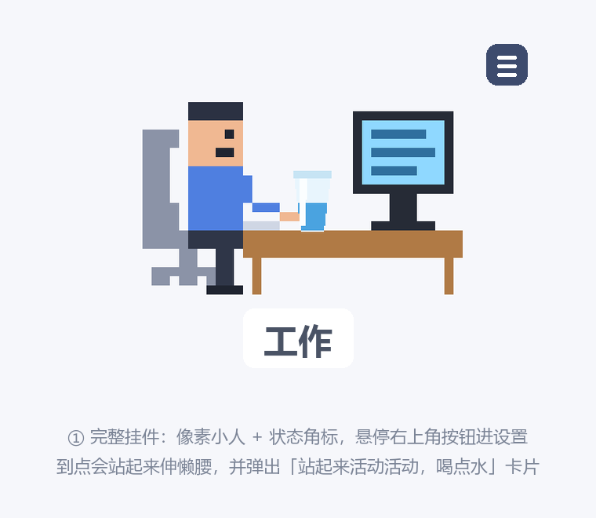
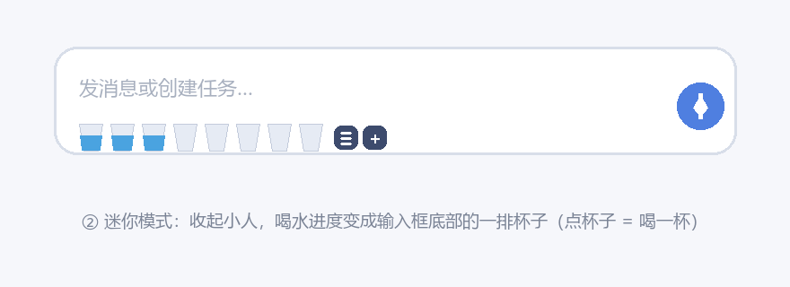

### 插件地址 / Plugin link

dsh-stand-reminder

### 简短说明 / Summary

Pixel-art stand-up and hydration reminder for the DSH desktop widget area. A tiny worker sits at a desk in the bottom-right corner of the chat page; every 30 minutes he stands up and stretches, a reminder card appears and a short chime plays. A glass on the desk fills at your chosen cups-per-day pace, and clicking it counts one cup. A mini mode collapses the whole widget into a row of cups under the chat composer, so it never covers the conversation. Everything runs as a plain in-page timer: no messages are delivered, no agent is woken, no tokens are spent, and nothing goes over the network.

- Repository: https://github.com/zjhWater/BigWater4Workers
- npm: https://www.npmjs.com/package/dsh-stand-reminder

### 插件实际效果 / Plugin screenshots

These two are pixel-accurate renders of the widget (the same SVG the plugin draws), not captures of the running app.

### 补充信息 / Additional details

- Tested on DSH 0.2.2-rc.1, desktop profile, Windows 11.
- Category suggestion: Health / productivity (健康 / 效率).
- Install: `plugin_manager install_bundle  target = dsh-stand-reminder`, then fully quit and reopen the client.
- Bundle declares `dsh.bundle.patch`, `engines.dsh >= 0.2.0`, MIT license. No runtime dependencies beyond Node built-ins.
- Storage is local only: one `localStorage` key plus `~/.dsh/dsh-stand-reminder.json` written through the plugin's own host route.
